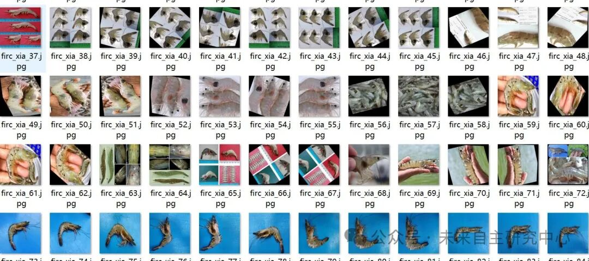
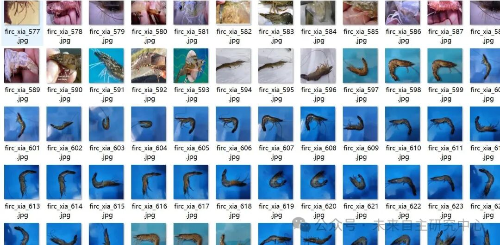
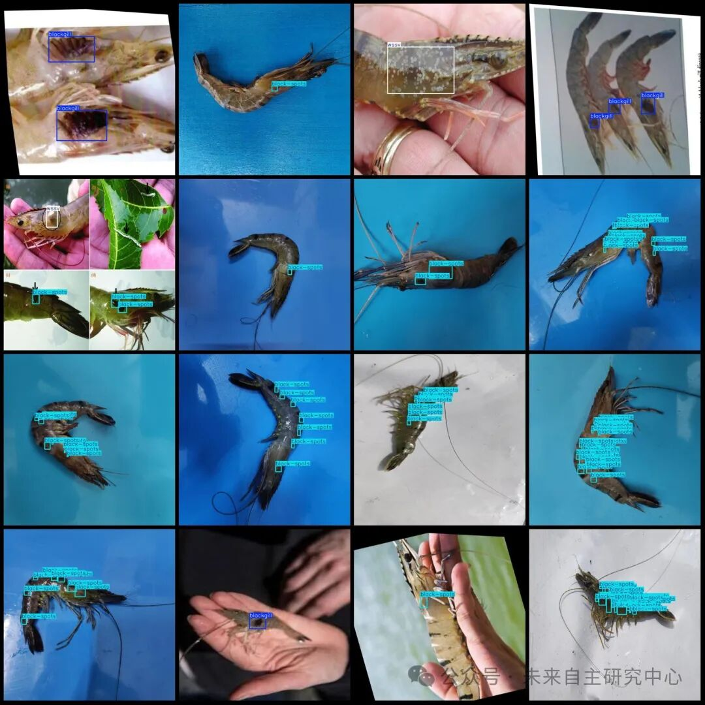

# Shellfish Disease Detection Dataset VOC+YOLO format with 923 images in 3 categories

Some enhanced images are included in the dataset.

Dataset format: Pascal VOC format + YOLO format (txt file without split path, only containing jpg images and corresponding VOC format xml files and yolo format txt files)

Number of images (number of jpg files): 923

Number of annotations (number of xml files): 923

Number of annotations (number of txt files): 923

Label category count: 3

Label category names (note that the order of yolo format categories does not correspond to this, but is based on the labels folder's classes.txt): ["black-spots", "blackgill", "wssv"]

Number of boxes labeled in each category:

black-spots Frame Count = 4287

Blackgill frame count = 556

Number of wssv boxes = 172

Total frame count: 5015

Using labelImg:

Annotation rules: Draw a rectangle around the category.

Important Notice: No

Special : This dataset does not guarantee the accuracy or precision of the trained models or weight files. The dataset is provided with accurate and reasonable annotations only.

Image Preview:

Annotation example:

## Payment

Here is a pay link on Stripe ( https://buy.stripe.com/3cs8yP7sY87d0vu9AB ). Please contact me lonlonago@foxmail.com after funding $89, and I will send you a complete data files , thank you!

